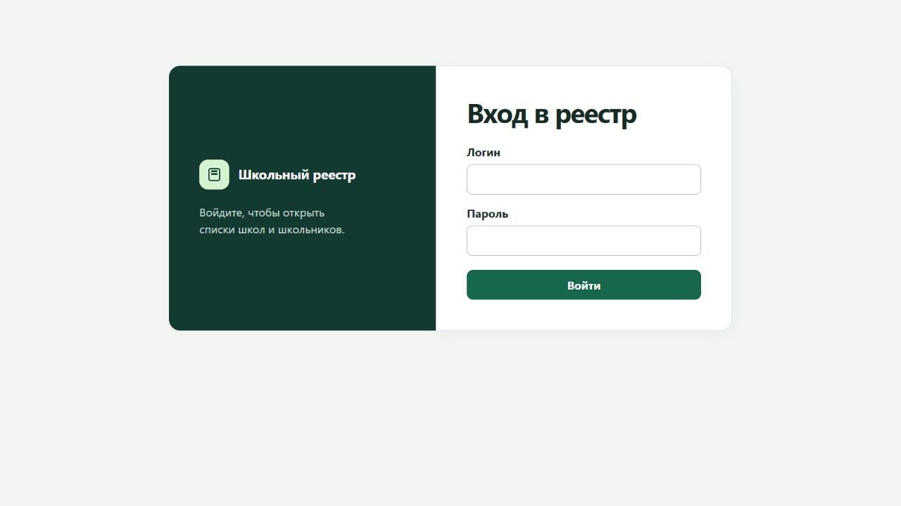
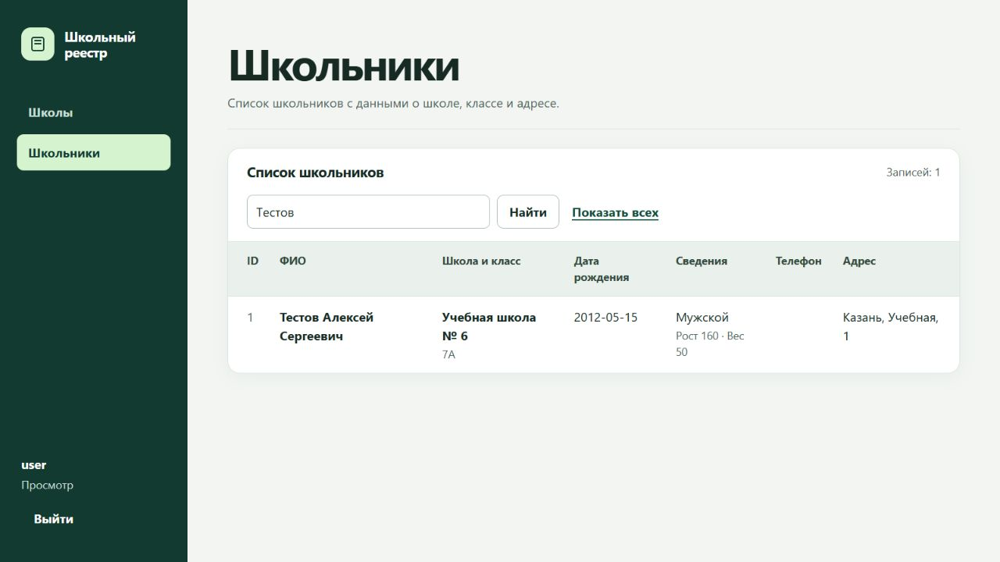
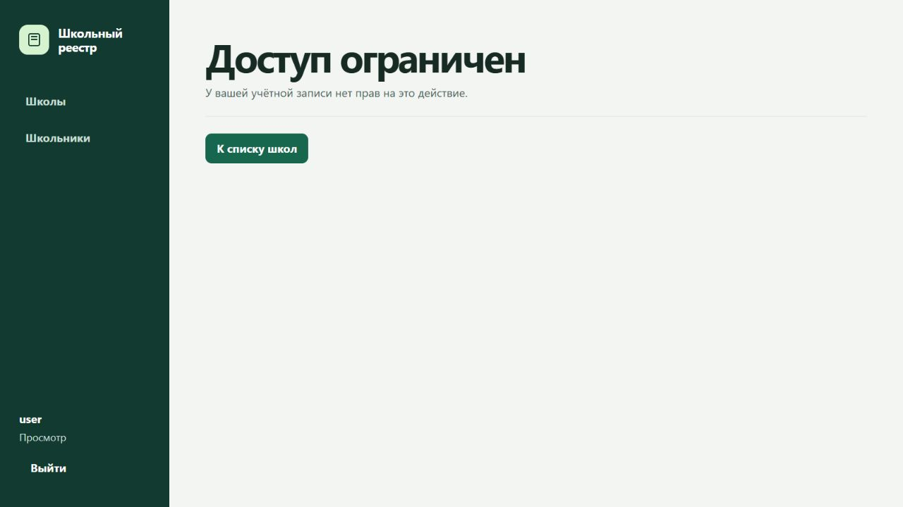
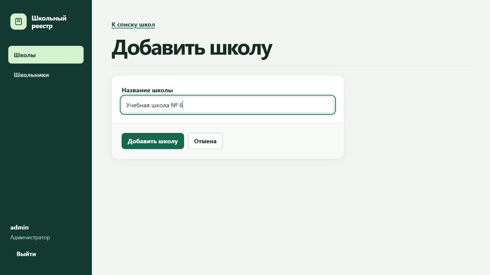
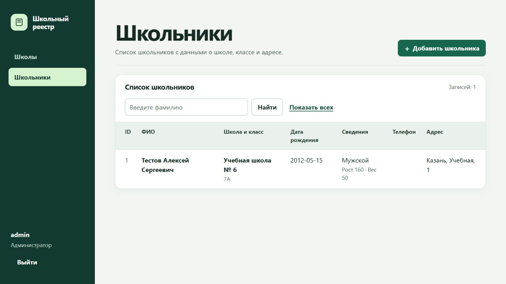
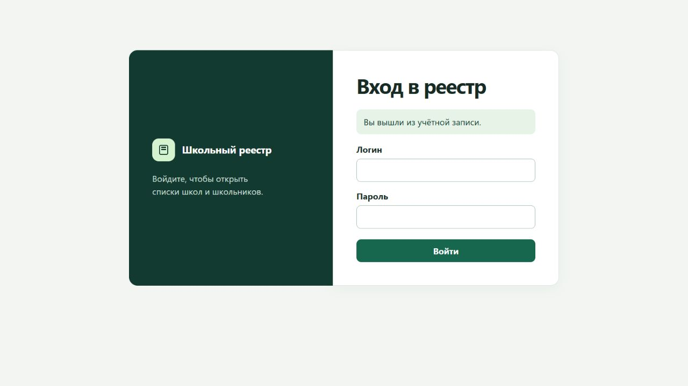

# Лабораторная работа № 6 — Аутентификация пользователей

Вариант 2 — «Школьник».

## Цель работы

Добавить вход через HTML-форму с помощью Spring Security. Разграничить просмотр школьного реестра и добавление записей по ролям пользователя.

## Архитектура проекта

- **Стек** — Java 17+, Spring Boot 3.5.16, Maven, Spring MVC, Thymeleaf, Spring Security 6, Spring JDBC и Bean Validation.
- **СУБД** — файловая H2. Схема описана в `src/main/resources/schema.sql`. Школы, школьники и учётные записи хранятся в `data/schooldb.mv.db`. Тесты используют отдельные базы H2 в памяти.
- **Controller** — `LoginController` строит страницу входа и страницу отказа. `SchoolController` показывает список и форму школы. `SchoolchildController` показывает список, выполняет поиск по фамилии и принимает форму школьника.
- **Security и Service** — `SecurityConfig` задаёт правила маршрутов, вход, выход и BCrypt. `DbUserDetailsService.loadUserByUsername` загружает учётную запись. Профиль `lab-demo` создаёт отсутствующие локальные учётные записи при первом запуске.
- **Repository** — `SchoolRepository.findAll/findById/save` работает со школами. `SchoolchildRepository.findAll/findByLastNameContainsIgnoreCase/save` работает со школьниками. `AddressRepository` сохраняет и загружает адреса. `UserRepository.findByUsername/insert` работает с учётными записями.
- **Представление** — шаблоны Thymeleaf в `src/main/resources/templates`, общий CSS в `src/main/resources/static/css/portal.css`. `sec:authorize` управляет видимостью действий, `sec:authentication` выводит имя входа.
- **Ключевые аннотации** — `@Configuration`, `@EnableWebSecurity`, `@Bean`, `@Profile`, `@Controller`, `@GetMapping`, `@PostMapping`, `@ModelAttribute`, `@InitBinder`, `@DateTimeFormat`, `@Valid`, `@Service`, `@Repository`, `@Transactional`.

### Модели данных и DTO

| Тип | Назначение |
| --- | --- |
| `School` | ID и название школы. Одна школа может иметь много школьников. |
| `Schoolchild` | ФИО, класс, дата рождения, пол, национальность, рост, вес, телефон, школа и адрес. Ссылки хранятся в `school_id` и `address_id`. |
| `Address` | Индекс, страна, область, район, город, улица, дом и квартира. |
| `AppUser`, `Role` | ID, уникальный логин, хеш пароля и одна из ролей `ROLE_USER` или `ROLE_ADMIN`. |
| `SchoolForm` | DTO HTML-формы, принимает и проверяет название школы. |

Форма школьника заполняет разрешённые поля `Schoolchild` и вложенного `Address`. Школа приходит отдельным числовым полем `schoolId`, по которому контроллер загружает запись из базы. HTML-форма входа передаёт поля `username` и `password` фильтру Spring Security.

### Мапперы

- `SchoolRepository` и `AddressRepository` преобразуют строки SQL в `School` и `Address` через `RowMapper`.
- `SchoolchildRepository` получает результат SQL JOIN и одним маппером собирает школьника, школу и адрес.
- `UserRepository` отображает строку из таблицы `users` в `AppUser`. Сервис преобразует его в `UserDetails` с логином, сохранённым хешем и полномочием роли.

## Алгоритм работы

1. Гость запрашивает защищённую страницу. Spring Security сохраняет адрес запроса и перенаправляет на `GET /login`.
2. Пользователь отправляет HTML-форму на `POST /login`. Фильтр загружает учётную запись из H2 и сравнивает пароль с BCrypt-хешем. Ошибка ведёт на `/login?error`.
3. После успешного входа сервер сохраняет аутентификацию в HTTP-сессии, а браузер получает cookie `JSESSIONID`. Spring возвращает к ранее запрошенной странице или к списку школ. JWT для этой схемы не используется.
4. На каждом запросе проверяются права роли. `USER` читает списки и ищет по фамилии. `ADMIN` дополнительно открывает и отправляет формы добавления. Для `USER` обе операции добавления возвращают `403`.
5. Thymeleaf добавляет CSRF-поле в POST-формы, включая вход, сохранение и выход. `POST /logout` завершает сессию и открывает `/login?logout`.

| Действие | Гость | USER | ADMIN |
| --- | --- | --- | --- |
| `GET /login` | Доступ | Доступ | Доступ |
| Списки и поиск | Переход на вход | Доступ | Доступ |
| `GET` и `POST` на `/schools/new`, `/schoolchildren/new` | Вход для GET | 403 | Доступ |
| `POST /logout` из формы | — | Выход | Выход |

Маршруты `/api/**` из предыдущей работы закрыты правилами доступа. Лабораторная проверяется через HTML-страницы.

### Локальный запуск

Из каталога проекта в PowerShell 7 задай свои учебные пароли и запусти приложение.

```powershell
$env:SPRING_PROFILES_ACTIVE = 'lab-demo'
$env:LAB_USER_PASSWORD = Read-Host 'Учебный пароль для user' -MaskInput
$env:LAB_ADMIN_PASSWORD = Read-Host 'Учебный пароль для admin' -MaskInput
.\mvnw.cmd spring-boot:run
```

В IntelliJ IDEA те же три переменные можно указать в конфигурации запуска `Lb2Application`. Открой [страницу входа](http://localhost:8080/login), затем войди как `user` или `admin` с заданным паролем. Профиль слушает только локальный интерфейс. При повторном запуске уже сохранённые пароли остаются действующими.

Для демонстрации в отдельной конфигурации IntelliJ можно добавить `SERVER_PORT=8081` и `SPRING_DATASOURCE_URL=jdbc:h2:mem:lb6-demo`. Тогда реестр откроется [на порту 8081](http://localhost:8081/login) с временной базой. При перезапуске профиль заново создаст демонстрационные учётные записи, а созданные в демо школы и школьники исчезнут. Для хранения записей между запусками используется файловая база по умолчанию. Значения учебных паролей задаются локально при запуске.

Автоматическая проверка — `.\mvnw.cmd clean test`. Тест запуска проверяет, что контекст приложения загружается. Три сценария MockMvc проверяют перенаправление гостя и неверный пароль, права `USER` на открытие и отправку форм, права `ADMIN` на добавление школы и школьника, отказ без CSRF и завершение сессии.

## Скриншоты результатов тестирования

Гость открыл защищённый список и увидел собственную форму входа.



Неверный пароль вернул пользователя на форму с сообщением об ошибке.


Под ролью USER доступен поиск, а кнопка добавления скрыта.



Прямой переход USER на форму добавления вернул HTTP 403.



Под ролью ADMIN открылась форма школы. После сохранения школы и школьника новая запись отобразилась в списке.





После выхода открылась страница входа с подтверждением.


